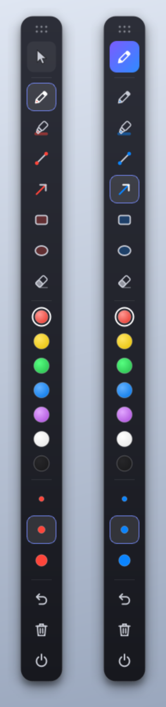
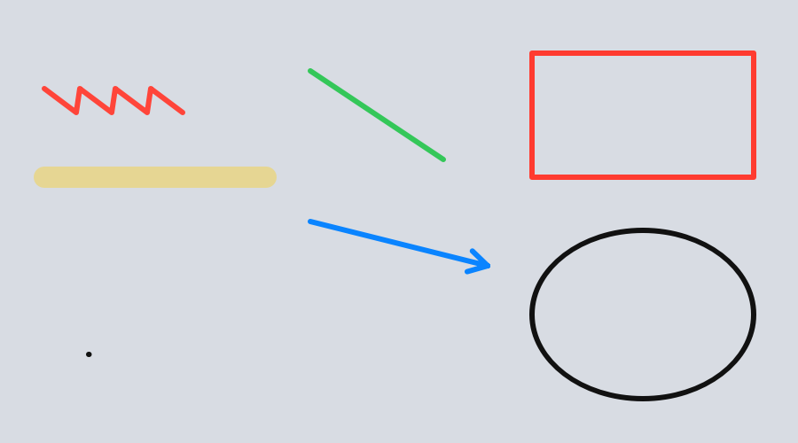

# Screen Draw

Draw, highlight and annotate directly on top of anything on your screen — then click straight through your drawings to keep working.

Screen Draw puts a transparent, always-on-top canvas over your monitor and gives you a small floating toolbar to control it. Toggle draw mode on to sketch over a video, a slide, code, a website, anything. Toggle it off and your mouse goes back to your apps while the annotations stay visible.

<p align="center">
  
</p>

## Features

- **Click-through overlay** — with draw mode off, clicks pass to the windows underneath; your drawings stay on screen.
- **Floating toolbar** — compact, vertical, draggable anywhere; always stays above the canvas.
- **Tools** — pen, highlighter, line, arrow, rectangle, ellipse.
- **Stroke eraser** — removes whole strokes it touches, with a ring cursor showing its reach.
- **7 colors and 3 sizes** — icons tint to your current ink color so you always know what you'll draw with.
- **Brush cursor** — a ring the exact size and color of your brush.
- **Undo and clear all** — every stroke, erase and clear can be undone.
- **Lives in the system tray** — hide the toolbar and bring it back from the tray; launching again just re-shows the running copy.
- **Standalone Windows app** — builds to `ScreenDraw.exe` with a Start Menu shortcut you can pin to the taskbar, plus an optional *Start with Windows* toggle.
- **Crisp at any scale** — all icons are drawn as vector art, so they're sharp on high-DPI displays.

<p align="center">
  
</p>

## Getting started

Requires **Python 3.10+**. Built and tested on **Windows 10/11**.

```bash
git clone https://github.com/1-apex/screen-draw.git
cd screen-draw
pip install -r requirements.txt
python screen_draw.py
```

### Install as a Windows app

Build a standalone `ScreenDraw.exe` (no Python needed to run it afterwards) and install it for your user account — no admin rights required:

```powershell
.\build.ps1     # builds dist\ScreenDraw\ScreenDraw.exe
.\install.ps1   # copies it to %LOCALAPPDATA%\Programs\ScreenDraw and adds a Start Menu shortcut
```

Then open **Start → Screen Draw**, and to pin it: right-click **Screen Draw** in the Start Menu → **Pin to taskbar**. Clicking the pinned icon while the app is already running simply brings the toolbar back.

To remove it again (including the *Start with Windows* entry):

```powershell
.\install.ps1 -Uninstall
```

> If PowerShell blocks the scripts, run them with `powershell -ExecutionPolicy Bypass -File .\build.ps1` (and the same for `install.ps1`).

## How to use

| Toolbar control | What it does |
| --- | --- |
| ⠿ Grip | Drag to move the toolbar |
| Pointer / pen button | Toggle draw mode. Pointer = clicks pass through, pen = drawing |
| Tool buttons | Pick pen, highlighter, line, arrow, rectangle, ellipse or eraser (turns draw mode on) |
| Color swatches | Choose ink color |
| Size dots | Small, medium or large stroke width (highlighter is 4× wider) |
| Undo | Step back one action |
| Trash | Clear everything |
| Down arrow | Hide the toolbar to the tray (drawings stay on screen) |
| Power | Quit |

**Tray icon** — left-click to show or hide the toolbar. Right-click for *Show/Hide toolbar*, *Draw mode*, *Clear all*, *Start with Windows* and *Quit*.

## How it works

- The overlay is a frameless, translucent Qt window covering the primary monitor.
- On Windows, the `WS_EX_TRANSPARENT` extended style is toggled via `ctypes` so the overlay ignores the mouse when draw mode is off. In draw mode it paints an almost-invisible fill (alpha 1) so it can catch clicks across the whole screen.
- Strokes are stored as simple objects; undo keeps snapshots of the stroke list, and the eraser hit-tests each stroke's outline with `QPainterPathStroker`.
- A `QLocalServer` named pipe keeps it single-instance: a second launch tells the running copy to show its toolbar, then exits.
- *Start with Windows* writes a per-user entry under `HKCU\Software\Microsoft\Windows\CurrentVersion\Run`.

| File | Purpose |
| --- | --- |
| [`screen_draw.py`](screen_draw.py) | The whole app |
| [`build.ps1`](build.ps1) | Builds the exe with PyInstaller and trims unused Qt modules (~67 MB) |
| [`install.ps1`](install.ps1) | Per-user install / uninstall with Start Menu shortcut |
| [`tools/make_icon.py`](tools/make_icon.py) | Renders the vector app icon to `assets/icon.ico` |

## Limitations

- Covers the primary monitor only.
- Drawings are not saved; they last until you clear them or quit.
- No keyboard shortcuts yet — everything is on the toolbar.
- Click-through uses the Win32 API; other platforms fall back to Qt's `WindowTransparentForInput`, which is untested.

## Roadmap

- Global hotkey to toggle draw mode
- Save or copy the annotated screen as an image
- Text tool
- Multi-monitor support

## License

[MIT](LICENSE)
